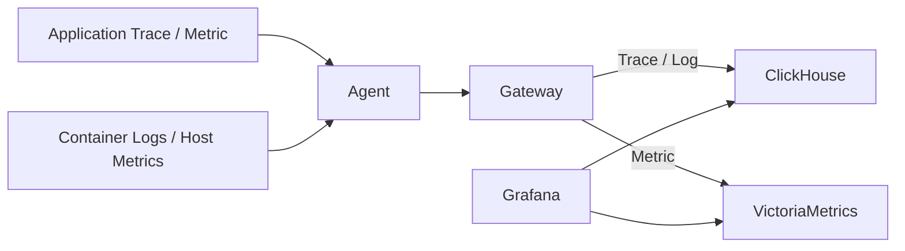

# Signet

Signet combines a single-host Docker Compose observability platform with a Go SDK
for application metrics, distributed traces, and correlated logs in Grafana.

## Architecture



## Quick start

On a Linux Docker host with Compose v2, run from the repository root:

```bash
# First installation only; keep an existing .env.
cp compose/.env.example compose/.env
chmod 600 compose/.env
# Edit compose/.env and replace both password placeholders before starting.
# First installation: generate local TLS certificates and API keys (requires OpenSSL).
./compose/generate-dev-credentials.sh
docker compose --env-file compose/.env -f compose/docker-compose.yaml up -d
```

Open [Grafana](http://127.0.0.1:3000) with the credentials in `compose/.env`.
Connect an application to populate its dashboards.

## Guides

- [Platform installation](docs/install-compose.md): configuration, application networking, verification, and operations.
- [Bearer API key / mTLS deployment](compose/README.md#optional-bearer-api-key-and-mtls-deployment): default API key authentication and optional mTLS/plaintext modes.
- [Go / Kratos SDK integration](docs/integrate-sdk.md): instrumentation, logging, and context propagation.
- [Standalone example](examples/standalone/README.md) · [Kratos example](examples/go-kratos/README.md).
- [SDK telemetry tests](tests/README.md).

[MIT License](LICENSE).
